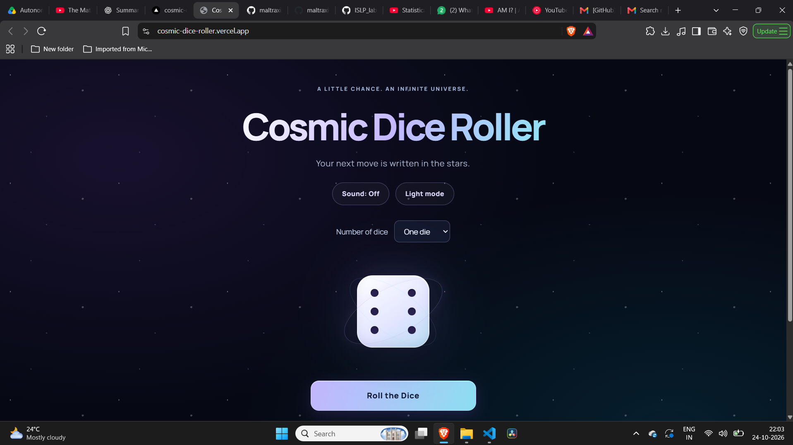
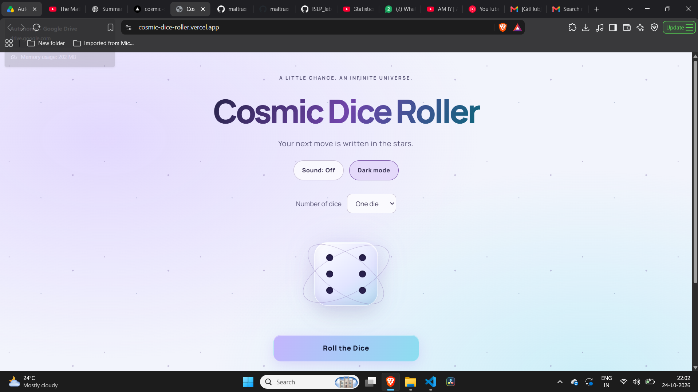

# Cosmic Dice Roller

[Open the website](https://cosmic-dice-roller.vercel.app/)

A browser-based dice roller built for the Programming Club’s
Software Division induction at IIT Indore.

Roll one or two dice, see the total, and review your recent rolls.
The interface has a space-inspired design with animated dice,
optional sound effects, and light and dark themes.

## Features

- One-die and two-dice modes.
- Dice faces drawn with CSS.
- A short spin animation before each result.
- History of the last 10 rolls.
- Sound effects with an on/off control.
- Light and dark themes, with the selected theme saved.
- Responsive layout and reduced-motion support.

## Built with

HTML, CSS and vanilla JavaScript. Sound is generated using the
Web Audio API, so no audio files are needed. The site is hosted
on Vercel.

## Run locally

Clone the repository:

    git clone https://github.com/maltraxis-lang/cosmic-dice-roller.git

Open the folder and double-click `index.html` to launch the site
in your browser. No installation or build step is required.

The Google Font needs an internet connection. If it cannot load,
the site uses a fallback font.

## How the dice work

Each die gets its value from:

    Math.floor(Math.random() * 6) + 1

`Math.random()` returns a value from 0 up to, but not including, 1.
Multiplying by 6, rounding down, and adding 1 gives an integer
between 1 and 6.

Each outcome occupies an equal-sized interval. In two-dice mode,
the function is called separately for each die. Repeated results
are normal.

The result appears after the animation. The roll button is
disabled while the dice are moving to prevent overlapping rolls.
This uses pseudorandom numbers suitable for a casual simulation,
not security-sensitive applications.

## Files

| File | Purpose |
| --- | --- |
| `index.html` | Page structure and controls |
| `style.css` | Layout, dice faces, animations and themes |
| `script.js` | Rolling logic, history, sound and theme controls |
| `screenshots/` | Screenshots of the website |

## Light theme

## Current limitations

Roll history resets when the page is refreshed. Only the theme
preference is saved in browser storage. Sound starts off and
must be enabled manually.